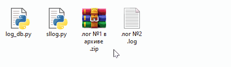

# Чтение лог файлов сигнализаций StarLine

StarLine ограничивает возможности смотреть логи неавторизованным установщикам.
Если вы считаете себя достаточно квалифицированным специалистом, то эта программа вам пригодится. 

Поддерживаются логи до версии **2.36** включительно.

Для декодирования версии **2.37** и новее отправьте файл боту [@sllogbot](https://t.me/sllogbot) 
или на почту [sllogbot@gmail.com](mailto:sllogbot@gmail.com) 

## Как пользоваться

1. Лог необходимо выгрузить кнопкой <kbd></kbd> - "Выгрузить лог" в программе StarLine Master.

   Если вы выгрузили его командой LOGLOAD, то он будет отправлен на сервер StarLine и вы не сможете его посмотреть.

   Также имейте в виду, что повторная выгрузка сохранит только новые записи с момента предыдущей выгрузки. 

2. Установить [Python 3](https://www.python.org/downloads/), скачать скрипты и запустить декодирование у себя на компьютере
   > 

   или
   
   Выгруженный файл можно отправить боту [@sllogbot](https://t.me/sllogbot) 
   или на почту [sllogbot@gmail.com](mailto:sllogbot@gmail.com)


## Конфиденциальные данные, которые могут попасть в лог
- код экстренного выключения охраны
- номер телефона владельца
- местоположение по GPRS
- местоположение по GPS
- текст СМС сообщений


## Что есть в логах
- напряжение аккумулятора
- температура салона/двигателя
- заряд батарейки метки
- уровень сигнала
- состояние дверей, датчиков, педалей, кнопок итп.
- причины запуска/не запуска двигателя
- многое другое...


## Чего в логах нет
- сервисного кода
- измерений просадки напряжения аккумулятора в момент кручения стартера
- многого другого...


## Дополнительно

```slconfig.py``` - распаковка/упаковка файлов настроек StarLine

---

## Лицензия и отказ от ответственности

### Программный код
Исходный код проекта распространяется под лицензией **MIT** (см. файл [LICENSE](LICENSE)).
Вы можете свободно копировать, изменять и использовать его в любых целях при условии сохранения уведомления об авторстве.

### Данные
В проекте используются данные, полученные из открытых источников.
* **Отсутствие прав собственности:** Автор не заявляет прав собственности на агрегированные данные.
Все права на исходные материалы принадлежат их соответствующим владельцам.
* **Без гарантий:** Данные предоставляются исключительно в ознакомительных и исследовательских целях.
Автор не гарантирует их точность, полноту или актуальность.
* **Ответственность:** Автор не несет ответственности за любые убытки, претензии или последствия,
возникшие в результате использования или распространения этих данных.
Пользователь самостоятельно отвечает за соблюдение авторских прав первоисточников.
